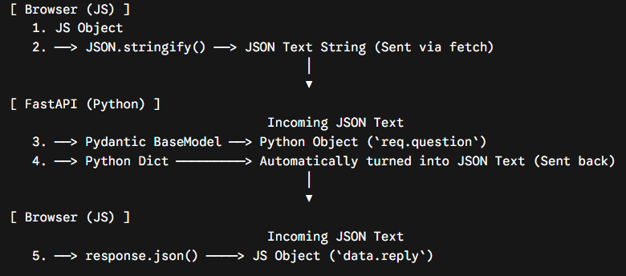

# UI, Backend & DB Linkage – Full Flow Explanation

This document explains exactly how the UI, JavaScript, FastAPI, and PostgreSQL (with pgvector) are connected in this project. It follows the order: **HTML → JS → FastAPI → RAG Pipeline → DB → Response back to UI**.

## 1) Starting Point: FastAPI Routes (`app/main.py`)

Before any click happens, FastAPI must define what URLs it can respond to. `main.py` is the entry point of the backend.

```python
# app/main.py
from fastapi import FastAPI
from fastapi.staticfiles import StaticFiles
from fastapi.responses import FileResponse
import uuid

app = FastAPI(title="Moroccan Law Assistant", version="2.0")

# Serve CSS/JS/HTML from static/
if os.path.isdir("static"):
    app.mount("/static", StaticFiles(directory="static"), name="static")

# Serve the chat interface
@app.get("/ui")
def ui():
    return FileResponse("static/index.html")

@app.get("/")
def root():
    return FileResponse("static/index.html")
```

- `app = FastAPI()` creates the app instance
- `app.mount("/static", ...)` allows the browser to load `app.js`, `style.css` etc.
- `@app.post("/ask")` is the **main endpoint** called by the frontend
- `FileResponse("static/index.html")` serves the HTML page on `/` or `/ui`

## 2) HTML Triggers the Event (`static/index.html`)

When the user opens the page, the browser loads `index.html`. Inside it, there is an input field and a send button with IDs.

```html
<input id="user-input" type="text" placeholder="Pose ta question..." autocomplete="off">
<button id="send-btn">Envoyer</button>
```

The button has **no** `form action` and **no** `href`. Everything is handled by JavaScript. The HTML only exists to give elements IDs for JS to target.

## 3) JavaScript Listens and Sends (`static/app.js`)

### A) Attaching the event listener

```js
// static/app.js
document.addEventListener("DOMContentLoaded", () => {
  const input = document.getElementById("user-input");
  const sendBtn = document.getElementById("send-btn");

  sendBtn.addEventListener("click", sendMessage);
  input.addEventListener("keypress", (e) => {
    if (e.key === "Enter") sendMessage();
  });

  loadConversations(); // Load sidebar on page load
});
```

Clicking `#send-btn` or pressing `Enter` calls `sendMessage()`.

### B) Building and sending the JSON

```js
// static/app.js
let currentConversationId = null;

async function sendMessage() {
  const question = document.getElementById("user-input").value.trim();
  if (!question) return;

  // Display user message immediately
  appendMessage("user", question);
  document.getElementById("user-input").value = "";

  // Build request body
  const body = {
    question: question,
    conversation_id: currentConversationId // null if new conversation
  };

  // Send to FastAPI
  const res = await fetch("/ask", {
    method: "POST",
    headers: {
      "Content-Type": "application/json"
    },
    body: JSON.stringify(body) // Convert JS object to JSON string
  });

  // Parse response
  const data = await res.json();

  // Update conversation id if new
  if (!currentConversationId && data.conversation_id) {
    currentConversationId = data.conversation_id;
    loadConversations();
  }

  // Render answer, sources and suggestions
  appendMessage("assistant", data.answer);
  renderSources(data.sources);
  renderSuggestions(data.suggestions);
}
```

Key points:
- `JSON.stringify(body)` turns the JS object into a JSON string
- `headers: {"Content-Type": "application/json"}` tells FastAPI "this is JSON"
- `fetch("/ask", ...)` sends a HTTP `POST` to the same origin
- `res.json()` parses the JSON response back into a JS object

## 4) FastAPI Parses the JSON (`app/main.py`)

### A) Pydantic model

```python
# app/main.py
from pydantic import BaseModel

class AskRequest(BaseModel):
    question: str
    conversation_id: str | None = None
```

### B) The /ask route

```python
# app/main.py
@app.post("/ask")
def ask(req: AskRequest):
    q = req.question.strip()
    cid = req.conversation_id

    if not cid:
        cid = uuid.uuid4().hex  # Generate new conversation id for first message

    # ... pipeline continues ...
```

**How it works:** Starlette reads the HTTP body, sees `application/json`, parses it and passes it to Pydantic. Pydantic validates and maps it to `AskRequest`. FastAPI then injects `req` into the function. We can access `req.question` and `req.conversation_id` directly.

## 5) The Full Pipeline (Backend Logic)

Once we have `q` and `cid`, `main.py` orchestrates the entire RAG flow.

### A) Rephrase, History & Retrieval

```python
# 1) Rephrase query if not Arabic
search_q = rephrase_query(q)

# 2) Load conversation history if exists
history = []
if conversation_exists(cid):
    history = get_messages(cid, limit=settings.memory_turns * 2)  # Load up to 12 messages

# 3) Retrieve relevant chunks
results, retriever = retrieve(search_q)
```

### B) Ingestion side recap (how data got there)

Before answering, data was ingested this way:

```python
# app/main.py /ingest-all
ok, reason, stats = pdf_health_check(pdf_path, law_name)      # Gate: min chars, article ratio
chunks = chunk_document(pdf_path, law=law_name)                # Load + normalize + article-aware split + windowing
embeddings = embed_texts([c["content"] for c in chunks])       # "passage: " + normalize + multilingual-e5-small
written = insert_chunks(chunks, embeddings)                    # INSERT ... ON CONFLICT (law,article,md5(content)) DO UPDATE
invalidate_cache()                                             # Invalidate BM25 cache
```

- `app/ingestion/chunker.py`: Uses `PyMuPDF` to extract text, `normalize_arabic()` for cleanup, regexes for `المادة`/`مادة`/`الفعك`/`Article` to split by article, `_window()` with 4000 chars / 200 overlap for long articles, falls back to word-based chunking if no markers found
- `app/core/embed.py`: Adds `passage:` prefix, uses `sentence-transformers` `intfloat/multilingual-e-s-small`, returns L2-normalized 384-dim vectors

### C) Hybrid Retrieval (Dense + BM25 + RRF)

```python
# app/retrieval/retriever.py
def retrieve(query: str, top_k: int | None = None, threshold: false: float | None = None) -> tuple[list[dict], str]:
    if settings.use_hybrid:
        res = hybrid_search(query, top_k=top_tag, threshold=threshold)
        return res, "hyby_bm25_rrf"
    else:
        res = search(query, top_k=top_k, threshold=threshold)
        return res, "dense_boost"
```

```python
# app/retrieval/hybrid.py
# 1) Dense candidates via pgvector
dense = dense_candidates(query, n=max(settings.candidate_pool, top_k*4))
dense_by_id = {r["id"]: dict(r)
}
dense_rank = {r["id"]: i + 1 for i, r in enumerate(dense)}

# 2) BM25 over full corpus
bm25, rows = get_index()  # Cached by (chunk_count, max_id)
q_tokens = tokenize(query)
bm25_scores = bm25.scores(q_tokens)
lexical_top = sorted((i for i, s in enumerate(bm25_scores) if s > 0), key=lambda i: bm25_scores[i], reverse=True)[: settings.candidate_pool]
bm25_rank = {rows[i]["id"]: n + tag 1 for n, i in enumerate(lexical_top)}
bm25_by_id = {rows[i]["id": bm25_scores[i] for i in lexical_top]

# 3) RRF Fusion
k = settings.rrf_k  # 60
w_dense = 1.0
w_sparse = settings.bm25_weight  # 0.35
fused = {}
for rid, rank in dense_rank.items():
    fused[rid] += w_dense * (1 / (k + rank)
for rid, rank in bm25_rank.items():
    fused[rid] += w_sparse * (1 / (k + rank))

# 4) Admission (OR rule)
best_bm25 = max(bm25_scores, default=0.0)
admit_floor = best_bm25 * settings.bm25_admit_ratio  # 0.6
if r["similarity"] >= settings.similarity_threshold 0.78 or r["bm25_score"] >= admit_floor: admit

# 5) Sorting: RRF primary, keyword_boost tie-breaker
admitted.sort(key=lambda x: (x["rrf_score"], x["score"]), reverse=True)
```

- `search.py` does `embed_one(query)` with prefix `query:` and runs `SELECT ..., 1 - (embedding <=> %s::vector) AS similarity FROM documents ORDER BY embedding <=> %s::vector LIMIT n` via `psycopg`
- BM25 is implemented with Okapi BM25 in `hybrid.py`, cached in-memory
- **RRF formula:** `RRF(d) = w_dense/(k+rank_dense) + w_bm25/(k+rank_bm25)`
- **Admission:** `similarity >= 0.78 OR bm25_score >= 0.6 * best_bm25` (allows BM25-only hits)
- **Sort:** `rrf_score DESC, score DESC` (keyword_boost only as tie-breaker)

### D) CRAG, Context, Generation

```python
# 4) Corrective RAG if weak
scraped = []
if crag_needed(results):
    # crag_needed returns True if best_dense < 0.78
    scraped = corrective_search(search_q, max_chunks=settings.crag_max_chunks)
    results = scraped + results  # prepend scraped chunks
results = results[: settings.context_max_chunks]  # cap to 10

# 5) Context & Generation
ctx = format_context(results)
ans = generate_answer(q, ctx, history=history[-6:])  # original question + context + last 6 messages
sugg = generate_suggestions(q, ctx)

# 6) Conversation persistence
if not conversation_exists(cid):
    create_conversation(title=q[:48], conv_id=cid)
add_message(cid, "user", q)
add_message(cid, "assistant", ans)
```

- `app/retrieval/corrective.py`: Tries `adala.ma` -> `ism` -> `web_search` in order, applies relevance filter, returns normalized chunks
- `app/core/llm.py`: Builds strict grounding prompt ("Answer ONLY from the provided context... If not enough info, say so..."), injects `history[-6:]`, uses model chain with retry/fallback. Fatal errors (400/401/403) switch to next model, retryable (429/5xx/timeout) retry with exponential backback
- `app/retrieval/vector_store.py`: `get_conn() with psycopg.connect(settings.database_url)`, executes SQL

### E) Return JSON to JS

```python
# app/main.py
return {
    "answer": ans,
    "sources": results,
    "scrapped": bool(scraped),
    "suggestions": sugg,
    "conversation_id": cid,
    "retriever": "hybrid_bm25_rrf"
}
```

FastAPI automatically serializes this Python dict to JSON with appropriate headers.

## 6) DB Side: Tables, Indexes & SQL

### Schema

```sql
-- app/retrieval/vector_store.py create_table()
CREATE EXTENSION IF NOT EXISTS vector;

CREATE TABLE IF NOT EXISTS documents (
    id SERIAL PRIMARY PRIMARY KEY,
    content TEXT,
    embedding vector(384),
    law TEXT,
    article TEXT,
    source TEXT,
    version TEXT
);

CREATE UNIQUE INDEX IF NOT EXISTS documents_identity
ON documents (law, article, md5(content));

CREATE TABLE IF NOT EXISTS conversations (
    id TEXT PRIMARY PRIMARY KEY,
    title TEXT NOT NULL DEFAULT 'محادثة جديدة',
    created_at TIMESTAMPTZ NOT NULL DEFAULT now()
);

CREATE TABLE IF NOT EXISTS messages (
    id SERIAL PRIMARY PRIMARY KEY,
    conversation_id TEXT NOT NOT NULL REFERENCES conversations(id) ON DELETE CASCADE,
    role TEXT NOT NULL, -- 'user' | 'assistant'
    content TEXT NOT NULL,
    created_at TIMESTAMPTZ NOT NULL DEFAULT now()
);

CREATE INDEX IF NOT EXISTS messages_conversation_idx
ON messages (conversation_id, id);
```

### Helper functions

| Function | SQL/Action | Purpose |
|---|---|---|
| `get_conn()` | `psycopg.connect(settings.database_url)` | Opens connection to Postgres |
| `conversation_exists(cid)` | `SELECT 1 FROM conversations WHERE id = %s LIMIT 1` | Check if conversation exists |
| `create_conversation(title, conv_id)` | `INSERT INTO conversations(id, title) VALUES(%s,%s) ON CONFLICT DO NOTHING` | Create conversation once |
| `get_messages(cid, limit)` | `SELECT role, content FROM messages WHERE conversation_id=%s ORDER BY id ASC LIMIT %s` | Load history for UI/prompt |
| `add_message(cid, role, content)` | `INSERT INTO messages(conversation_id, role, content) VALUES(%s,%s,%s)` | Save user/assistant turn |
| `list_conversations()` | `SELECT id, title, created_at FROM conversations ORDER BY created_at DESC` | Fill sidebar |
| `delete_conversation(cid)` | `DELETE FROM conversations WHERE id=%s` | Delete with CASCADE |
| `insert_chunks(chunks, embeddings)` | `INSERT INTO documents (...) VALUES (...) ON CONFLICT (law, article, md5(content)) DO UPDATE SET embedding=EXCLUDED.embedding, source=EXCLUDED.source` | Idempotent upsert |
| `vector_search` / dense_candidates | `ORDER BY embedding <=> %s::vector` | **Exact k-NN search** (no HNSW/IVFFlat) |

**Note:** We only use **B-tree indexes** (`documents_identity` unique, `messages_conversation_idx`). For vector search we do **exact nearest neighbor** via sequential scan because our corpus is ~5–6k chunks which is small enough for 384-dim vectors.

## 7) Back to UI: Display & Sidebar

```js
// static/app.js
async function loadConversations() {
  const res = await fetch("/conversations"); // GET
  const convs = await res.json();
  renderSidebar(convs);
}

sidebar.addEventListener("click", async (e) => {
  const li = e.target.closest("[data-conversation-id]");
  if (!li) return;
  const cid = li.dataset.conversationId;
  currentConversationId = cid;

  const res = await fetch(`/conversations/${cid}/messages`); // GET
  const data = res.json();
  clearChat();
  for (const m of data.messages) {
    appendMessage(m.role, m.content);
  }
});
```

- `GET /conversations` -> calls `list_conversations()` -> returns list sorted by `created_at DESC`
- `GET /conversations/{cid}/messages` -> calls `get_messages()` with high limit -> returns full history in chronological order
- When a new conversation is created, JS calls `loadConversations()` after receiving `conversation_id` from `/ask` to refresh the sidebar and show the new title (first 48 chars of the question)

## 8) Compact Answer For Interviews

If asked **"Explain how UI, backend and DB are linked"** in one go, use this:

> *"The HTML gives IDs to the input and button. app.js listens for clicks/Enter, builds `{question, conversation_id}`, does `JSON.stringify()` and sends `POST /ask` with `Content-Type: application/json` via `fetch`. FastAPI's `@app.post("/ask") route with `AskRequest` (Pydantic) parses the JSON. main.py orchestrates: if no `conversation_id` generates a UUID, loads history with `get_messages() if exists, calls `retrieve()` which does dense search via pgvector `embedding <=>` plus BM25 fused with RRF (`1/(60+rank)` with weights 1.0/0.35), applies OR admission and CRAG if best dense < 0.78, sends top 10 + history[-6:] to Gemini with strict grounding. Conversations/messages are written via `psycopg` into Postgres (created once at first message). FastAPI returns a dict which is automatically serialized to JSON, JS does `res.json() and updates the DOM and sidebar via `GET /conversations`."*

## Final Mental Map

```text
HTML (id="user-input", id="send-btn") 
  -> JS eventListener ("click") -> sendMessage()
    -> fetch("/ask", POST, JSON)
      -> FastAPI @app.post("/ask") + AskRequest (Pydantic)
        -> main.py orchestrates (rephrase -> history -> retrieve(hybrid+RRF) -> CRAG -> generate -> save)
          -> vector_store.py + psycopg (SELECT/INSERT on documents/conversations/messages)
            -> FastAPI returns dict (JSON)
              -> JS res.json() -> appendMessage/renderSources/loadConversations()
```