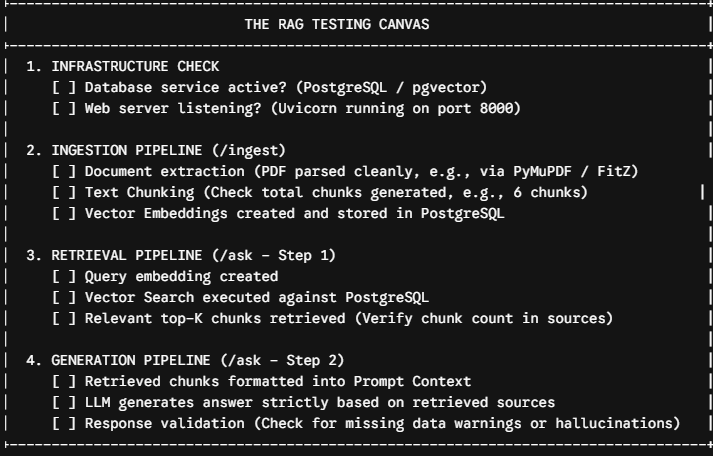
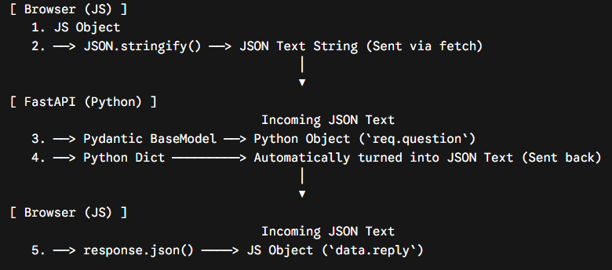

The Project: Uni Assistant
What it is
A WhatsApp chatbot that answers questions about your university, using only your school's official documents (PDFs, syllabi, guides). A student texts a question in Arabic/French/English/Darija → the bot replies with an answer grounded in the actual documents, plus a citation showing where the answer came from.

The problem it solves
At your university (and every university), students constantly ask the same questions:

"When is the PFE submission deadline?"
"What documents do I need for registration?"
"Which courses are in the Data Engineering track?"
"What's the exam schedule?"
These questions get repeated in WhatsApp group chats. Admins repeat themselves. Answers go stale. New students ask the same thing every year. Information gets buried in group messages and people can't find it.

What Uni Assistant does
Instead of asking in a group and waiting for someone to answer (or getting the wrong answer), a student texts the bot directly:

"what's the registration deadline?" → bot answers: "The registration deadline is 15 September 2026. [source: registration-guide.pdf | page 3]"
"what documents do I need?" → bot answers: "You need: CNIE, photos, transcript, medical certificate. [source: registration-guide.pdf | page 5]"
"does it accept Darija?" → bot answers in Darija back
The answer comes only from official documents, never hallucinated. Every claim has a source the student can verify.

## How it works (architecture)

## The offline pipeline (ingestion)
* Before the bot can answer anything, documents must be indexed: 

Evaluation
A list of 20 real questions with known correct answers is used to score the system:

Fact score: what percentage of expected facts appear in the answer?
Citation score: does the answer cite the correct source?
This gives you concrete numbers to show in interviews.

The creative touch (what makes it yours, not a tutorial)
It's for YOUR university, with YOUR documents
It works in multiple languages (Arabic/French/English/Darija) — most tutorials only do English
It has citations that are validated at runtime (the answer must reference a real chunk)
It's evaluated with real scores, not "looks good to me"
It's deployed and tested by your actual classmates

